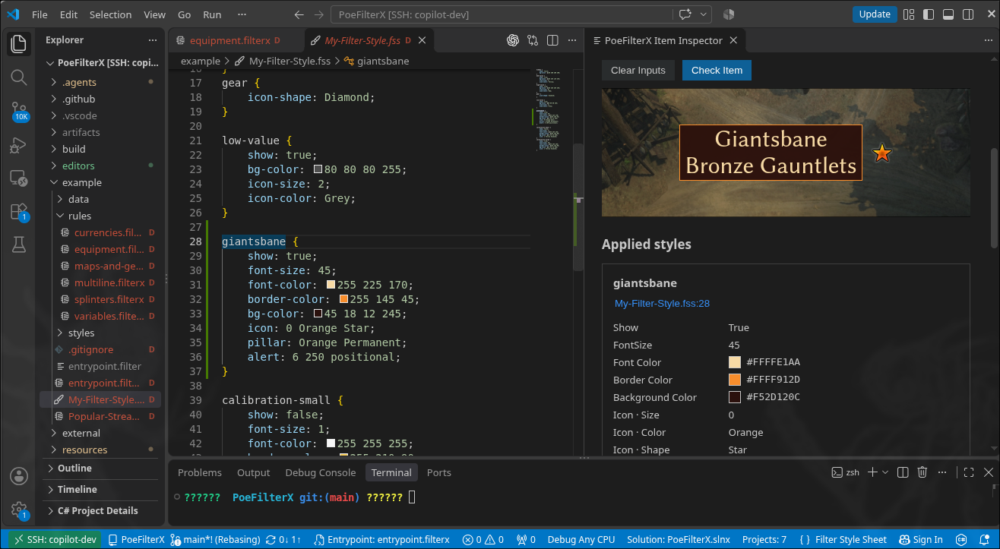

# PoeFilterX for VS Code

Edit your filterx projects, preview how items will look, and build your `.filter` files from VS Code.

## Write and edit with assistance

- **Suggestions as you type** for filter commands, style properties, values, style names, and imports.
- **Error and warning highlights** with details in VS Code's Problems panel.
- **Hover help** for commands, properties, and style declarations.
- **Color swatches and a color picker** for adjusting your styles.
- **Go to Definition and Find References** to navigate styles and their uses.
- **Rename styles across files** to keep declarations and references in sync.
- **Formatting, highlighting, folding, and an outline** to keep larger files easy to navigate.

## Preview items and inspect their styles

Copy an item from Path of Exile and paste it into **PoeFilterX: Inspect Item** to see how your filter treats it.

- Preview the item's label, text size, colors, border, and minimap icon.
- See which filter block matches and which styles apply.
- Follow links back to the rules and style declarations in your files.
- Trace overridden values to understand where the final appearance comes from.
- Inspect items from Path of Exile 1 or Path of Exile 2, with controls for area level and item properties.

## Manage and build your project

- Run **PoeFilterX: Initialize Project** to create a project in your workspace.
- Choose your filter with **PoeFilterX: Select Entrypoint**, or click the entrypoint in the status bar.
- Run **PoeFilterX: Build** to generate your `.filter` file and jump to build errors from the Problems panel.
- Use VS Code's build tasks to build individual entrypoints.
- Run **PoeFilterX: Restore Packages** to download your project's package dependencies.

## Get started

Open your filter project folder in VS Code. Open the Command Palette and run **PoeFilterX: Inspect Item** to try the preview, or **PoeFilterX: Build** to build your filter.

For help creating your first filter project, follow [this guide](https://github.com/SteffenBlake/PoeFilterX/wiki/Your-First-Project).
